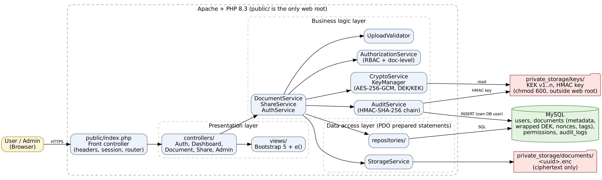
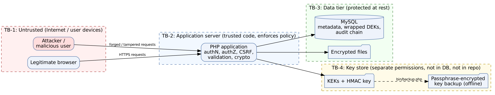

# System Architecture

**Layers.** Presentation (`controllers/`, `views/`), Business logic (`services/`), Data access (`repositories/`, `StorageService`). Controllers contain no SQL and no cryptography; services contain no HTML. `public/index.php` is the single entry point and the only PHP file under the web root.

**Upload flow.** Browser → front controller (headers, session, CSRF) → `DocumentController::upload` → `DocumentService::upload` → `UploadValidator` → generate DEK → AES-256-GCM encrypt (nonce 1, AAD) → wrap DEK with active KEK (nonce 2) → write `<uuid>.enc` → insert metadata row → append audit record.

**Download/view flow.** Request → authenticated session → `fetchAuthorized` (`AuthorizationService::can`) → read ciphertext → unwrap DEK → AES-GCM decrypt (tag verified) → SHA-256 compare → audit record → stream in memory.

**Technology.** PHP 8.3 core PHP, PDO prepared statements, PHP OpenSSL, MySQL, Apache, Bootstrap 5 (CDN), PHPUnit.

**Folder structure.**

| Folder | Purpose |
|---|---|
| `public/` | Only web-exposed folder: `index.php`, CSS, JS |
| `config/` | Env loader, constants, PDO, helpers, bootstrap |
| `controllers/` | Request handling (presentation layer) |
| `models/` | Exception types used across layers |
| `services/` | Business logic, crypto, authorization, audit |
| `repositories/` | All SQL |
| `views/` | HTML templates (everything escaped with `e()`) |
| `private_storage/` | Encrypted files, keys, logs (outside web root, ignored by Git) |
| `database/` | `database.sql`, optional `audit_user.sql` |
| `bin/` | Setup, rotation, backup, restore, seed, demo |
| `tests/` | PHPUnit tests, test environment, HTTP end-to-end script |

