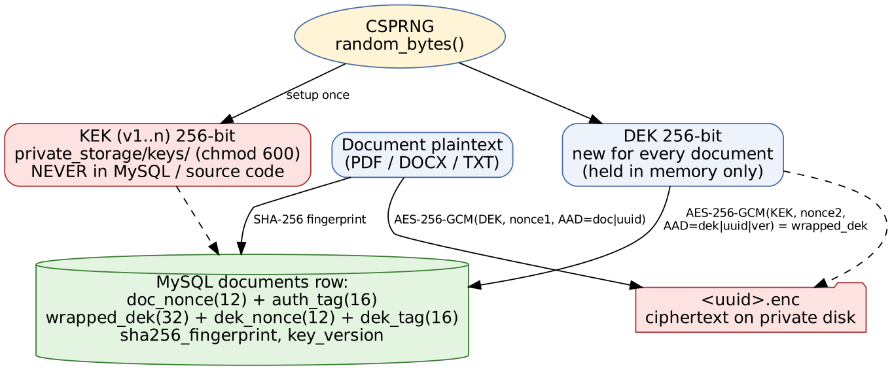

# Cryptographic Design

## Algorithms
| Purpose | Algorithm | API |
|---|---|---|
| Password hashing | Argon2id (64 MiB, 3 iterations, 1 lane) | `password_hash/verify` |
| Document encryption | AES-256-GCM, 96-bit nonce, 128-bit tag | `openssl_encrypt/decrypt` |
| DEK protection | AES-256-GCM under the KEK, separate nonce | same |
| Fingerprint | SHA-256 | `hash()` |
| Audit | HMAC-SHA-256 + hash chain | `hash_hmac()` |
| Keys, nonces, tokens | CSPRNG | `random_bytes()` |
| Key-backup protection | PBKDF2-HMAC-SHA256 (600 000 it.) → AES-256-GCM | `hash_pbkdf2`, OpenSSL |
| Transport | HTTPS / TLS 1.3 preferred | Apache + OpenSSL |

No algorithm is implemented from scratch.

## Why AES-GCM and what authenticated encryption means
Ordinary encryption (e.g. AES-CBC) gives confidentiality but not integrity: an attacker can flip bits and the receiver may decrypt garbage without noticing. An ordinary hash such as SHA-256 has no key: anyone who can change the file can also recompute the hash, so a hash stored next to the data proves nothing against an attacker who can edit both. **Authenticated encryption** (AES-GCM) produces a tag that can only be computed with the secret key; decryption fails if the ciphertext, nonce, tag or AAD was altered. The SHA-256 fingerprint is an *additional* check that detects accidental corruption, wrong-key/wrong-record mix-ups, and (because the fingerprint is in the database, a different component) modification of the file alone.

## Nonce and key rules
A new 12-byte random nonce is generated for every encryption; document encryption and DEK wrapping use different nonces. A DEK is used for exactly one document and one encryption (on update a *new* DEK and nonce are generated), so a (key, nonce) pair is never reused. KEKs wrap many DEKs with random 96-bit nonces; with random nonces the collision probability stays negligible for far more than this system's number of documents (NIST SP 800-38D limits are around 2³² invocations per key).

## AAD (additional authenticated data)
Document: `doc|<storage uuid>`. DEK wrap: `dek|<storage uuid>|<kek version>`. A ciphertext copied onto another document's file, or a wrapped DEK moved to another row, fails authentication (tested).

## Key lifecycle
1. **Generation** – `bin/setup_keys.php` creates `kek_v1.key` and `hmac.key` once using exclusive file creation (`fopen 'x'`), mode 600; it refuses to run if keys or key metadata exist, so a production KEK is never regenerated.
2. **Use** – every upload wraps a fresh DEK with the *active* KEK; reads use the KEK version recorded in the row.
3. **Rotation** – `bin/rotate_kek.php` creates the next KEK, marks it active, unwraps each DEK with its old KEK and rewraps with the new one (new nonce); document files are untouched; safe to resume. Verified: documents still verify after two rotations.
4. **Backup** – `bin/backup.php` encrypts all key files with a passphrase-derived key. Verified: restore produced byte-identical files; a wrong passphrase is rejected.
5. **Recovery** – see Chapter 10. Old KEK versions must be kept as long as any backup needs them.
6. **Destruction** – deleting a document deletes its row and encrypted file; a deleted DEK can no longer be unwrapped. (SSD wear-levelling means file deletion is not forensic erasure.)

## Trust assumptions and limits
- The server process is trusted with plaintext during requests (not end-to-end encryption).
- KEK and encrypted files live on the same server; separation relies on file permissions and separate backup storage. A production deployment would move the KEK to a KMS/HSM.
- Whole-file encryption, 10 MB limit, memory limit raised to 256 MB per upload request; no custom streaming format was invented.
- Rotation changes the wrapping layer; if a *DEK* is believed exposed the document itself must be re-encrypted (not automated).
- Metadata (filenames, sizes, owners) is not encrypted.
